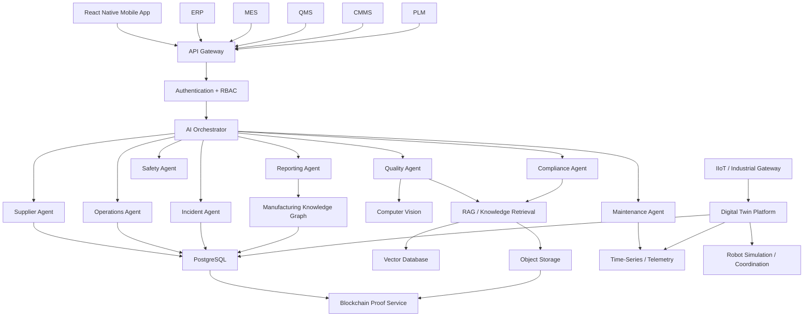
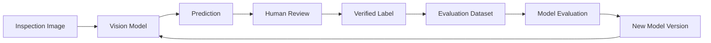
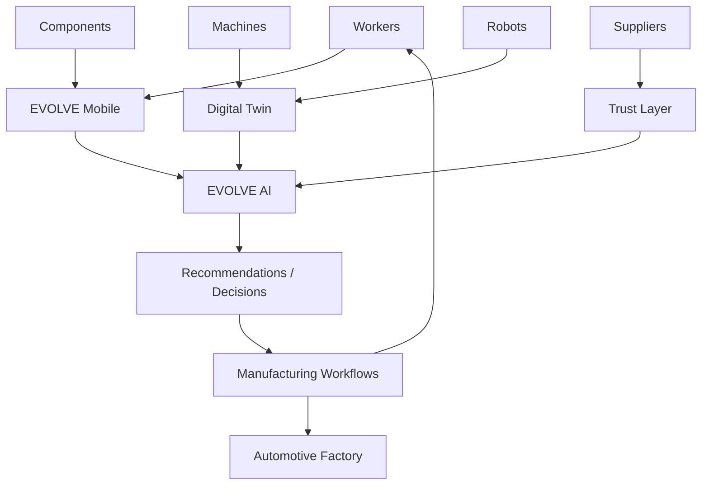

# EVOLVE INSIGHT 🚗🤖 

## AI-Powered Manufacturing Intelligence for Automotive Factories

> **See the factory. Understand the factory. Improve the factory.**

EVOLVE Insight is a mobile-first AI manufacturing intelligence platform designed for automotive factories, Tier-1 suppliers, Tier-2 suppliers, quality teams, maintenance teams, production supervisors, and frontline manufacturing workers.

The platform combines:

* 📱 React Native mobile workflows
* 👁️ AI computer-vision inspection
* 🤖 Multi-agent manufacturing Copilot
* 🧠 Retrieval-Augmented Generation (RAG)
* 🏭 Factory digital twins
* 🤝 Human-robot interaction workflows
* 🦾 Multi-robot coordination simulation
* 🔍 Quality and defect intelligence
* 🧩 Supplier intelligence
* 🔗 Blockchain-backed evidence verification
* 📊 Production analytics
* 📴 Offline-first mobile workflows
* 🔐 Enterprise security and auditability

EVOLVE is designed to sit **above and alongside existing manufacturing systems**, rather than attempting to replace the ERP, MES, QMS, PLM, CMMS, robotics controllers, or industrial safety infrastructure already deployed inside a factory.

---

# Table of Contents

1. [Vision](#vision)
2. [Problem](#problem)
3. [Solution](#solution)
4. [Core Product](#core-product)
5. [Key Features](#key-features)
6. [Architecture](#architecture)
7. [Technical Architecture Diagram](#technical-architecture-diagram)
8. [AI Architecture](#ai-architecture)
9. [Multi-Agent System](#multi-agent-system)
10. [Computer Vision](#computer-vision)
11. [Manufacturing Copilot](#manufacturing-copilot)
12. [RAG Knowledge System](#rag-knowledge-system)
13. [Digital Twin](#digital-twin)
14. [Robotics Intelligence](#robotics-intelligence)
15. [Human-Robot Interaction](#human-robot-interaction)
16. [Supplier Intelligence](#supplier-intelligence)
17. [Blockchain Trust Layer](#blockchain-trust-layer)
18. [Mobile Application](#mobile-application)
19. [Offline Mode](#offline-mode)
20. [Security](#security)
21. [Data Model](#data-model)
22. [API Design](#api-design)
23. [AI Safety](#ai-safety)
24. [Installation](#installation)
25. [Development](#development)
26. [Environment Variables](#environment-variables)
27. [Project Structure](#project-structure)
28. [Testing](#testing)
29. [Deployment](#deployment)
30. [Roadmap](#roadmap)
31. [Monetization](#monetization)
32. [Use Cases](#use-cases)
33. [Productionization](#productionization)
34. [Contributing](#contributing)
35. [License](#license)

---

# Vision

EVOLVE Insight aims to become the **AI intelligence layer for automotive manufacturing**.

Modern automotive factories contain enormous quantities of operational information:

* machine telemetry
* production schedules
* inspection results
* component data
* supplier information
* engineering documents
* maintenance records
* incident history
* robot state
* worker workflows

The problem is that this information is commonly distributed across multiple systems.

EVOLVE connects these information sources through an AI-driven mobile experience.

The goal is simple:

> **Give every manufacturing worker an intelligent operational assistant.**

A worker should be able to point a phone at a component and ask:

> “What is this?”

> “Is there a defect?”

> “Why was this flagged?”

> “What procedure applies?”

> “Has this happened before?”

> “Which supplier produced it?”

> “What should I do next?”

The same platform can eventually allow managers and engineers to ask:

> “Why is Line 04 underperforming?”

> “Which supplier is causing the most quality problems?”

> “Which equipment requires maintenance attention?”

> “What would happen if we changed the line configuration?”

---

# Problem

## Fragmented Manufacturing Data

Automotive factories operate across many software systems.

A simplified environment looks like:

```text
ERP
 |
MES
 |
QMS
 |
PLM
 |
CMMS
 |
Supplier Portal
 |
Industrial Systems
 |
Inspection Tools
```

Each system contains valuable information, but the worker often has to manually connect the dots.

---

# The Frontline Problem

A worker discovering a defect may need to:

1. Identify the component.
2. Find the correct procedure.
3. Search previous inspections.
4. Determine whether the defect is known.
5. Identify the supplier.
6. Create an incident.
7. Notify the appropriate person.
8. Document the result.

EVOLVE compresses this workflow into one mobile experience.

---

# Solution

EVOLVE Insight combines several capabilities into one operational platform.

## Observe

Use mobile cameras, QR codes, OCR, machine data, and factory events.

## Understand

Use computer vision, RAG, knowledge graphs, and manufacturing-specific AI agents.

## Predict

Identify anomalies, quality trends, equipment risk, and supplier deterioration.

## Recommend

Suggest inspections, investigations, maintenance reviews, and corrective actions.

## Verify

Create auditable evidence and optionally anchor selected records using blockchain.

## Human Approval

AI proposes.

Authorized humans decide.

Production systems execute through validated industrial workflows.

---

# Core Product

EVOLVE consists of several interconnected product modules.

```text
                 EVOLVE INSIGHT
                       |
       +---------------+---------------+
       |               |               |
    EVOLVE         EVOLVE          EVOLVE
    INSPECT      INTELLIGENCE       TRUST
       |               |               |
    Vision          Copilot        Evidence
    OCR             RAG            Provenance
    Inspection      Agents         Attestation
       |               |               |
       +---------------+---------------+
                       |
                  DIGITAL TWIN
                       |
                 FACTORY GRAPH
                       |
              MANUFACTURING DATA
```

---

# EVOLVE INSPECT

AI-assisted visual inspection directly from a mobile device.

Core workflow:

```text
Scan Part
   ↓
Identify Component
   ↓
Capture Image
   ↓
Image Quality Check
   ↓
Computer Vision
   ↓
Defect Classification
   ↓
Confidence
   ↓
Human Review
   ↓
Approve / Reject / Escalate
```

---

# EVOLVE INTELLIGENCE

The intelligence layer contains:

* Manufacturing Copilot
* Multi-agent architecture
* RAG
* Supplier intelligence
* Quality intelligence
* Predictive analytics
* Digital twin reasoning

---

# EVOLVE TRUST

The trust layer provides:

* cryptographic evidence hashes
* component provenance
* supplier attestations
* document integrity
* inspection proofs
* optional blockchain anchoring

The blockchain layer is deliberately separated from confidential operational data.

---

# Key Features

## AI Computer Vision

Detect potential:

* scratches
* cracks
* dents
* corrosion
* discoloration
* missing components
* misalignment
* incorrect labels
* surface anomalies
* assembly problems

---

## OCR

Read:

* serial numbers
* part numbers
* batch numbers
* supplier labels
* barcodes
* QR codes

---

## AI Copilot

Workers can ask questions about:

* inspections
* components
* suppliers
* procedures
* incidents
* maintenance
* production
* factory status

---

## Multi-Agent AI

Specialized agents handle specialized domains:

```text
               AI ORCHESTRATOR
                      |
      +---------------+---------------+
      |       |       |       |       |
   Quality Supplier Compliance Ops Maintenance
      |       |       |       |       |
      +-------+-------+-------+-------+
                      |
               Incident / Report
```

---

# Technical Architecture Diagram



---

# AI Architecture

EVOLVE uses a layered AI architecture.

## Layer 1 — Perception

Computer vision and OCR understand physical inputs.

## Layer 2 — Retrieval

RAG retrieves authoritative documents and historical evidence.

## Layer 3 — Reasoning

Specialized agents interpret the evidence.

## Layer 4 — Prediction

Machine-learning models estimate trends and risks.

## Layer 5 — Action Recommendation

AI suggests next steps.

## Layer 6 — Human Decision

A qualified person approves consequential actions.

---

# Multi-Agent System

The central AI component is the **AI Orchestrator**.

The orchestrator determines which specialist agents should participate.

For example:

> “Why is this component failing?”

may involve:

```text
Quality Agent
+
Supplier Agent
+
Compliance Agent
```

The orchestrator then synthesizes their findings.

---

# Quality Agent

Responsible for:

* inspection interpretation
* defect investigation
* quality trends
* historical inspection searches
* root-cause assistance
* component quality

Example:

> “Find similar defects for EV-39281.”

The Quality Agent retrieves relevant inspection history.

---

# Supplier Agent

Responsible for:

* supplier scores
* supplier trends
* batch history
* supplier incidents
* supplier risk
* supplier credentials

Example:

> “Why is NorthStar risk increasing?”

---

# Compliance Agent

Responsible for:

* SOPs
* specifications
* certifications
* work instructions
* quality policies
* procedural questions

The agent should ground answers in authoritative documents.

---

# Operations Agent

Responsible for:

* production status
* shift summaries
* throughput
* queues
* bottlenecks
* factory health

Example:

> “What requires attention before this shift ends?”

---

# Maintenance Agent

Responsible for:

* equipment health
* maintenance history
* machine anomalies
* maintenance recommendations
* asset context

---

# Safety Agent

Responsible for:

* approved safety information
* hazard reporting
* escalation workflows
* safety-document retrieval

Safety-critical actions should always follow the site's validated safety procedures.

---

# Incident Agent

Responsible for:

* investigations
* incident status
* assignments
* corrective actions
* root-cause assistance

AI-generated causes should be labeled as hypotheses until verified.

---

# Report Agent

Generates:

* shift summaries
* quality summaries
* supplier reports
* incident reports
* executive summaries

---

# Computer Vision

The vision pipeline is designed around **structured evidence**.

A result should contain:

```json
{
  "classification": "surface_anomaly",
  "confidence": 0.94,
  "severity": "medium",
  "regions": [
    {
      "x": 0.38,
      "y": 0.28,
      "width": 0.18,
      "height": 0.14
    }
  ]
}
```

The UI can then display the suspected region.

---

# Image Quality

The system should reject or request another image when the input is:

* blurry
* too dark
* overexposed
* obstructed
* poorly framed
* too low resolution

Example:

> **Move closer**

or:

> **Reduce glare**

This prevents poor image inputs from creating unreliable findings.

---

# Defect Taxonomy

Initial defect classes:

```text
surface_anomaly
scratch
crack
dent
corrosion
discoloration
missing_component
misalignment
incorrect_label
damaged_connector
assembly_error
packaging_damage
```

The taxonomy should remain configurable by customer and component family.

---

# Human-in-the-Loop Inspection

EVOLVE does not treat an AI prediction as the final quality decision.

```text
AI Prediction
     ↓
Human Review
     ↓
+----+----+----+
|         |    |
Approve  Reject Escalate
```

Human decisions can become feedback signals for AI evaluation and improvement.

---

# AI Feedback Loop



The production model should not automatically retrain from every worker decision.

Model updates should pass controlled evaluation and release processes.

---

# Manufacturing Copilot

The Copilot is designed around manufacturing context.

Examples:

```text
Why was EV-39281 flagged?

Show similar inspections.

What procedure applies to this component?

Why did supplier quality decline?

Summarize today's shift.

What incidents are still unresolved?

Which machines are showing elevated risk?
```

---

# Context Awareness

If a user is already viewing:

**Part EV-39281**

they can simply ask:

> “Why was this rejected?”

EVOLVE automatically supplies the current context.

Possible context:

* part
* inspection
* incident
* supplier
* line
* station
* factory
* user role

---

# RAG Knowledge System

The RAG layer provides access to approved organizational knowledge.

Potential sources:

* SOPs
* specifications
* engineering procedures
* quality manuals
* work instructions
* supplier documents
* training materials

---

# RAG Pipeline

```text
User Query
   ↓
Permission Check
   ↓
Intent Detection
   ↓
Hybrid Search
   ↓
Metadata Filtering
   ↓
Reranking
   ↓
Context Assembly
   ↓
LLM
   ↓
Citation Validation
   ↓
Answer
```

---

# Document Version Intelligence

The system should understand document versions.

Example:

```text
Q-104 v4.2
      ↑
Current

Q-104 v4.1
      ↑
Previous
```

When versions conflict, EVOLVE should surface the conflict instead of silently combining them.

---

# AI Citations

A Copilot response should provide evidence:

**Sources**

* Procedure Q-104 v4.2
* Inspection INS-10293
* Batch B-49281
* Specification PS-18

The mobile interface should make each source tappable.

---

# Digital Twin

The EVOLVE digital twin represents:

* factory
* zones
* production lines
* stations
* machines
* robots
* products
* components
* suppliers
* processes
* quality events

---

# Digital Twin Hierarchy

```text
Factory
 |
 +-- Zone
      |
      +-- Line
           |
           +-- Station
                |
                +-- Machine
                     |
                     +-- Tool
```

The same graph connects production objects:

```text
Supplier
   ↓
Batch
   ↓
Component
   ↓
Station
   ↓
Machine
   ↓
Inspection
   ↓
Defect
```

---

# Digital Twin State

A machine twin could expose:

```json
{
  "machineId": "PRESS-04",
  "state": "running",
  "healthScore": 88,
  "cycleCount": 184920,
  "currentJob": "ORDER-84721",
  "maintenanceRisk": "medium"
}
```

This gives workers and engineers a mobile view of factory state.

---

# Factory Map

The mobile application can provide a 2D factory map.

Example:

```text
+--------------------------------------+
| FACTORY HEALTH                       |
|                                      |
|  BODY SHOP       PAINT               |
|     ●               ●                |
|                                      |
|          ASSEMBLY                    |
|              ●                       |
|                                      |
|  QUALITY              WAREHOUSE      |
|      ●                    ●          |
+--------------------------------------+
```

Tap a zone to view its digital twin.

---

# 3D Digital Twin

A future implementation can add 3D factory visualization for:

* equipment
* robots
* stations
* conveyors
* materials
* process flow

3D should be used when it improves decision-making rather than merely decorating the application.

---

# Digital Twin + AI

A manager might ask:

> “Why is Station 07 underperforming?”

EVOLVE can combine:

* cycle time
* machine health
* queue length
* inspection results
* current production order
* maintenance events

The AI then provides an evidence-based explanation.

---

# Robotics Intelligence

EVOLVE can represent robots as digital objects.

Example:

```text
ROBOT-01
State: Working
Task: Pick Housing
Zone: Assembly A
Health: 98
Cycles: 192,442
```

The platform can support simulation of:

* task assignment
* workload balancing
* shared-zone occupancy
* robot state
* human interaction
* simulated faults

---

# Multi-Robot Coordination

A scheduling layer determines which simulated robot is most suitable for a task.

Factors can include:

* capability
* availability
* distance
* health
* battery state
* task priority
* shared-zone availability

Example:

```text
Task
 ↓
Candidate Robots
 ↓
Capability Filter
 ↓
Health Filter
 ↓
Zone Availability
 ↓
Assignment Score
 ↓
Recommended Robot
```

The orchestration layer should not bypass industrial robot safety systems.

---

# Human-Robot Interaction

The mobile application can support workflows such as:

```text
Robot requires assistance
        ↓
Worker notification
        ↓
Worker acknowledgement
        ↓
Authorized workflow
        ↓
Human task
        ↓
Completion
        ↓
Workflow state updated
```

The actual physical robot safety system remains separate from the cloud/mobile orchestration layer.

---

# Supplier Intelligence

Supplier profiles should contain:

* quality score
* inspection history
* defect history
* incident history
* active parts
* certification status
* risk trend

Example:

```text
NorthStar Components

Quality: 91.8
Trend: -4.2
Risk: LOW
Active Parts: 18
Open Incidents: 1
```

---

# Supplier Risk Intelligence

EVOLVE can explain risk rather than simply display a number.

Example:

> Quality risk increased because three related defects appeared during the previous two batches.

Potential inputs:

* defect rate
* batch quality
* incidents
* supplier trend
* certification
* delivery data

---

# Blockchain Trust Layer

Blockchain should be used selectively.

The recommended model is:

```text
              OFF-CHAIN
      +------------------------+
      | images                 |
      | documents              |
      | inspection details     |
      | supplier information   |
      | AI conversations       |
      +------------+-----------+
                   |
                  HASH
                   |
                   v
              ON-CHAIN
      +------------------------+
      | proof hash             |
      | timestamp              |
      | issuer                 |
      | attestation            |
      +------------------------+
```

This avoids placing confidential factory data on a public ledger.

---

# Component Provenance

A component can have a digital identity:

```text
EV-39281
    |
    +-- Supplier
    |
    +-- Batch
    |
    +-- Shipment
    |
    +-- Inspection
    |
    +-- Defects
    |
    +-- Corrective Action
    |
    +-- Verification
```

---

# Evidence Hashing

A canonical record can be hashed:

```text
Inspection
    ↓
Canonical JSON
    ↓
SHA-256
    ↓
Evidence Hash
    ↓
Blockchain Anchor
```

Later:

```text
Current Record
    ↓
Recalculate Hash
    ↓
Compare Against Anchor
```

A mismatch indicates that the current record is not identical to the anchored version.

---

# Merkle Batching

High-volume environments should avoid writing every event individually.

Instead:

```text
Inspection A ─┐
Inspection B ─┤
Inspection C ─┼─> Merkle Root
Inspection D ─┤
Inspection E ─┘
                  ↓
              Blockchain
```

This is considerably more scalable for large inspection volumes.

---

# React Native Architecture

The mobile app should provide five primary tabs:

```text
Home
Inspect
Parts
Copilot
Alerts
```

Additional screens:

* supplier profiles
* incidents
* machine twins
* robot status
* factory map
* settings
* reports

---

# Mobile Navigation

```text
Home
 |
 +-- Factory Health
 +-- AI Recommendations
 +-- Activity
 |
Inspect
 |
 +-- Camera
 +-- AI Result
 +-- Evidence
 |
Parts
 |
 +-- Search
 +-- Component
 +-- Traceability
 |
Copilot
 |
 +-- Chat
 +-- Sources
 +-- Recommended Actions
 |
Alerts
 |
 +-- Critical
 +-- Quality
 +-- Supplier
 +-- AI
```

---

# Offline Mode

Industrial facilities can have unreliable connectivity.

EVOLVE should support:

* local inspection capture
* local task state
* local evidence queue
* delayed uploads
* synchronization after reconnection

Architecture:

```text
Mobile
  ↓
Local Queue
  ↓
Offline
  ↓
Connectivity Restored
  ↓
Sync Engine
  ↓
Backend
```

---

# Synchronization

Every queued operation should have:

```text
jobId
operation
payload
createdAt
attempts
status
```

Possible states:

```text
queued
uploading
synced
failed
```

Idempotency keys prevent duplicate operations.

---

# API Design

Recommended API boundaries:

```text
/api/v1/auth
/api/v1/parts
/api/v1/inspections
/api/v1/incidents
/api/v1/suppliers
/api/v1/documents
/api/v1/copilot
/api/v1/twins
/api/v1/robots
/api/v1/tasks
/api/v1/recommendations
/api/v1/proofs
/api/v1/reports
```

---

# Example Copilot Request

```http
POST /api/v1/copilot/query
Content-Type: application/json
Authorization: Bearer <token>
```

```json
{
  "conversationId": "CONV-123",
  "message": "Why was EV-39281 flagged?",
  "context": {
    "partId": "PART-39281",
    "inspectionId": "INS-10293"
  }
}
```

---

# Example Response

```json
{
  "conversationId": "CONV-123",
  "answer": "EV-39281 was flagged because...",
  "agent": "quality",
  "confidence": 0.94,
  "citations": [
    {
      "id": "INS-10293",
      "title": "Inspection INS-10293",
      "type": "inspection"
    }
  ],
  "actions": [
    {
      "type": "request_reinspection",
      "requiresHumanApproval": true
    }
  ]
}
```

---

# Data Model

Core entities:

```text
Organization
Site
User
Role
Part
Batch
Supplier
Inspection
Defect
Incident
CorrectiveAction
Document
Machine
Robot
Station
Line
Twin
ProductionOrder
AIConversation
AIMessage
Recommendation
AuditEvent
Proof
```

---

# Example Relationship Model

```text
Organization
 |
 +-- Sites
      |
      +-- Lines
           |
           +-- Stations
                |
                +-- Machines
                +-- Robots
                |
                +-- Inspections
                     |
                     +-- Parts
                          |
                          +-- Suppliers
```

---

# AI Safety

The AI layer should include:

* permission-aware retrieval
* prompt-injection resistance
* tool authorization
* human approval
* audit logs
* model versioning
* source citations
* uncertainty handling

---

# “I DON'T KNOW” Behavior

EVOLVE should be comfortable responding:

> “I don't have enough evidence to determine that.”

Triggers can include:

* poor image quality
* low model confidence
* missing data
* conflicting documents
* insufficient retrieval evidence

This is preferable to generating unsupported manufacturing claims.

---

# Tool Authorization

Agents should never have unrestricted system access.

For example:

### Quality Agent

May:

* search inspections
* retrieve parts
* review defects

Should not automatically:

* delete records
* release quarantined materials
* modify safety settings

---

# Human Approval

Consequential actions follow:

```text
AI Recommendation
      ↓
User Review
      ↓
Permission Check
      ↓
Human Approval
      ↓
Backend Workflow
      ↓
Audit Event
```

---

# AI Observability

Track:

* request count
* latency
* model
* token usage
* retrieval success
* citation rate
* human acceptance
* false positives
* AI cost
* tool failures

---

# Model Evaluation

Maintain evaluation datasets covering:

* common defects
* rare defects
* difficult lighting
* different part variants
* supplier variation
* human/AI disagreement

Measure:

* precision
* recall
* F1
* false-positive rate
* false-negative rate
* latency
* cost

---

# Model Versioning

Store:

```text
modelId
version
provider
deploymentDate
evaluationScore
inputSchemaVersion
```

Every AI result should reference the model version that produced it.

---

# Project Structure

A production repository can eventually use:

```text
evolve-insight/
├── apps/
│   ├── mobile/
│   │   ├── app/
│   │   ├── components/
│   │   ├── hooks/
│   │   ├── services/
│   │   ├── store/
│   │   └── theme/
│   │
│   └── web/
│
├── services/
│   ├── api/
│   ├── ai-orchestrator/
│   ├── vision/
│   ├── rag/
│   ├── digital-twin/
│   ├── robotics/
│   ├── supplier-intelligence/
│   ├── proof-service/
│   └── notifications/
│
├── packages/
│   ├── types/
│   ├── validation/
│   ├── config/
│   └── sdk/
│
├── contracts/
│   └── blockchain/
│
├── infrastructure/
│   ├── docker/
│   ├── kubernetes/
│   └── terraform/
│
├── docs/
│
└── tests/
```

---

# Installation

## Requirements

Recommended development environment:

* Node.js
* npm or pnpm
* Expo
* React Native
* TypeScript
* Git

Create the mobile application:

```bash
npx create-expo-app@latest apps/mobile
```

Install the primary mobile dependencies:

```bash
cd apps/mobile

npx expo install expo-camera
npx expo install expo-secure-store
npx expo install expo-notifications
```

---

# Development

Start Expo:

```bash
npx expo start
```

Run type checking:

```bash
npx tsc --noEmit
```

Run tests:

```bash
npm test
```

Run linting:

```bash
npm run lint
```

---

# Environment Variables

Example:

```env
EXPO_PUBLIC_API_URL=http://localhost:4000/api/v1
EXPO_PUBLIC_ENV=development
```

Backend environment:

```env
DATABASE_URL=
VECTOR_DATABASE_URL=
OBJECT_STORAGE_URL=

LLM_BASE_URL=
LLM_API_KEY=
LLM_MODEL=

BLOCKCHAIN_RPC_URL=
BLOCKCHAIN_CHAIN_ID=

AUTH_ISSUER=
AUTH_AUDIENCE=
```

Never place:

* database passwords
* blockchain private keys
* LLM provider secrets
* enterprise credentials

inside the mobile bundle.

---

# Backend Development

A typical backend request flow:

```text
React Native
     ↓
API Gateway
     ↓
Authentication
     ↓
RBAC
     ↓
Service
     ↓
Database / AI / Twin / Proof
```

Each backend service should be independently testable.

---

# Database Strategy

Use PostgreSQL for:

* organizations
* users
* parts
* inspections
* incidents
* suppliers
* workflows
* audit records
* twin metadata

Use specialized storage where appropriate for:

* time-series telemetry
* vectors
* large media
* machine-learning artifacts

---

# Object Storage

Inspection photos and videos should be stored in object storage rather than directly in PostgreSQL.

Preferred pattern:

```text
Mobile
 ↓
Upload URL
 ↓
Object Storage
 ↓
Upload Confirmation
 ↓
Inspection Record
```

---

# Vector Database

RAG embeddings can be stored in a vector-capable system.

Each chunk should retain:

```text
documentId
version
source
organizationId
siteId
permissions
content
embedding
```

Permission metadata is important.

---

# Digital Twin Data

The twin should separate:

**current state**

from:

**historical telemetry**

For example:

```text
Twin State
    |
    +-- Current machine status
    +-- Current job
    +-- Current health
```

while historical telemetry lives separately.

---

# Robotics Service

The robotics subsystem should initially operate as:

**simulation + orchestration + monitoring**

rather than directly controlling physical robots.

Recommended interfaces:

```text
RobotRegistry
TaskScheduler
ZoneManager
SimulationEngine
HRIManager
RobotHealthService
```

---

# Human-Robot Interaction API

Example:

```http
POST /api/v1/hri/request
```

```json
{
  "robotId": "ROBOT-01",
  "zoneId": "ZONE-04",
  "reason": "Inspection assistance requested"
}
```

Possible state model:

```text
requested
    ↓
acknowledged
    ↓
work_in_progress
    ↓
completed
```

---

# Simulation

The robotics simulator can model:

* multiple robots
* shared zones
* tasks
* worker positions
* robot health
* faults
* task dependencies
* production orders

This enables testing before physical integration.

---

# Factory Simulation

Example scenario:

```text
Robot A
    ↓
Assembly Task 1

Robot B
    ↓
Assembly Task 2

Robot C
    ↓
Inspection Task

Human Worker
    ↓
Enters Shared Zone

System
    ↓
Pauses simulated workflow
    ↓
Creates HRI event
```

---

# Production Metrics

EVOLVE should track:

### Quality

* defect rate
* pass rate
* first-pass yield

### Operations

* throughput
* cycle time
* queue size

### Robotics

* utilization
* faults
* cycles

### AI

* inference cost
* latency
* accuracy

### Supplier

* supplier quality
* batch defects
* risk trend

---

# Factory Health Score

A high-level factory score could combine:

```text
Quality
+
Throughput
+
Equipment Health
+
Supplier Risk
+
Inspection Completion
```

The formula should be configurable and transparent rather than treated as a mysterious AI score.

---

# Alerts

EVOLVE should support:

### Critical

Immediate attention.

### Warning

Review recommended.

### Informational

Context update.

### AI

New model-generated recommendation.

---

# Push Notifications

Possible notifications:

> **Critical defect detected**

> **Supplier risk increased**

> **Inspection queue above target**

> **Robot assistance requested**

> **Maintenance review recommended**

> **Corrective action overdue**

---

# Executive Mode

Management users can receive:

```text
FACTORY HEALTH
96.4%

QUALITY
96%

THROUGHPUT
93%

SUPPLIER HEALTH
92%

OPEN CRITICAL EVENTS
2
```

The executive interface should remain separate from detailed operator workflows.

---

# Worker Mode

Workers see:

```text
MY TASKS

1. Inspect EV-39281
2. Review anomaly
3. Complete checklist
```

The product should reduce information overload.

---

# Engineer Mode

Engineers can see:

* digital twin
* machine state
* historical trends
* simulation
* defect patterns
* root-cause analysis

---

# Quality Manager Mode

Quality managers can see:

* inspection queue
* defect trends
* supplier risk
* incidents
* corrective actions
* AI recommendations

---

# Supplier Manager Mode

Supplier managers can see:

* supplier scores
* certifications
* incidents
* batches
* quality trends

---

# Security Architecture

Recommended controls:

```text
Identity
  ↓
Authentication
  ↓
Authorization
  ↓
Tenant Isolation
  ↓
Service Authorization
  ↓
Audit Logging
```

Use:

* TLS
* encrypted storage
* secure token handling
* role-based access control
* short-lived credentials
* secret-management systems

---

# Tenant Isolation

Every major record should carry organization context.

Conceptually:

```text
Organization A
    |
    +-- Site A
        +-- Parts
        +-- Inspections

Organization B
    |
    +-- Site B
        +-- Parts
        +-- Inspections
```

A user's request must never bypass tenant boundaries.

---

# Audit Logging

Important events:

* login
* inspection creation
* AI analysis
* human approval
* incident creation
* supplier changes
* document changes
* proof creation
* permissions changes

Example:

```json
{
  "actor": "USR-104",
  "action": "INSPECTION_APPROVED",
  "resource": "INS-10293",
  "timestamp": "..."
}
```

---

# AI Audit Trail

Store:

```text
User question
↓
Router
↓
Agent(s)
↓
Tools
↓
Retrieved sources
↓
AI output
↓
Human approval
↓
Final workflow
```

This enables investigation of AI-assisted decisions.

---

# Cybersecurity

EVOLVE is intended for industrial environments.

The platform should therefore treat:

**OT systems**

and:

**IT/cloud systems**

as distinct trust domains.

The mobile/cloud platform should never become an uncontrolled pathway into safety-critical factory controls.

---

# Deployment

A cloud architecture can use:

```text
Load Balancer
     ↓
API Gateway
     ↓
Microservices
     ↓
PostgreSQL
Vector DB
Object Storage
Telemetry
AI
```

Kubernetes can be introduced when scale justifies it.

---

# Edge Architecture

For factories requiring low-latency processing:

```text
Factory
 |
 +-- Edge Gateway
      |
      +-- Local Vision
      +-- Local Cache
      +-- Telemetry Buffer
      |
      +-- Secure Cloud Sync
```

This can improve resilience when network connectivity is unreliable.

---

# CI/CD

Recommended pipeline:

```text
Pull Request
     ↓
Lint
     ↓
Type Check
     ↓
Unit Tests
     ↓
Integration Tests
     ↓
Security Checks
     ↓
Build
     ↓
Staging
     ↓
Validation
     ↓
Production
```

---

# Testing Strategy

Tests should cover:

### Unit

* task scheduling
* risk calculations
* permissions
* validation
* AI routing

### Integration

* database
* AI services
* RAG
* digital twin
* proof service

### End-to-End

* mobile inspection
* inspection approval
* incident creation
* Copilot
* offline sync

---

# AI Evaluation Tests

Maintain test cases such as:

```text
Question
Expected Agent
Expected Sources
Expected Action
Expected Safety Behavior
```

Example:

```text
"Why was EV-39281 flagged?"
Expected:
Quality Agent
+
Inspection source
+
Specification source
```

---

# Performance

Target mobile behaviors:

* rapid launch
* responsive navigation
* lightweight first render
* efficient media handling
* bounded memory
* graceful offline behavior

Vision inference can be asynchronous.

Large reports should run as background jobs.

---

# Scalability

The system should scale independently across:

* mobile clients
* API servers
* AI workers
* vector search
* telemetry processing
* image processing
* blockchain proof batching

This avoids coupling expensive workloads to every user request.

---

# Monetization

Recommended initial SaaS model:

| Plan       |   Example Price | Target              |
| ---------- | --------------: | ------------------- |
| Explorer   |            Free | Evaluation          |
| Starter    | $149/month/site | Small manufacturers |
| Team       | $399/month/site | Growing teams       |
| Business   |      $999/month | Multi-site          |
| Enterprise |          Custom | Large manufacturers |

Optional expansion revenue:

* AI credits
* advanced Copilot
* supplier intelligence
* custom vision models
* enterprise integrations
* private deployment
* professional services
* blockchain verification
* API usage

---

# Business Model

The intended revenue architecture is:

```text
Base Subscription
       +
AI Usage
       +
Premium Modules
       +
Enterprise Integrations
       +
Professional Services
```

This lets smaller manufacturers begin with a low-friction deployment and grow into larger contracts.

---

# Ideal Customer

The best initial customer profile is:

> **Automotive component manufacturer with 1–3 plants, recurring inspection challenges, multiple suppliers, frontline quality workers, and fragmented manufacturing software.**

Potential buyer:

* Quality Manager
* Plant Manager
* VP Operations
* Manufacturing Engineering Manager
* Supplier Quality Manager

---

# Primary Use Case

A worker receives:

**EV-39281**

They scan the QR code.

EVOLVE retrieves:

* part history
* supplier
* batch
* specification

The worker takes a picture.

Vision detects a potential surface anomaly.

The Copilot retrieves the relevant specification.

The system finds two similar historical incidents.

The worker reviews the evidence.

The finding is escalated.

The digital twin updates the station's quality context.

The approved evidence can optionally be anchored for verification.

This is the core EVOLVE workflow.

---

# Secondary Use Cases

## Supplier Investigation

> “Why has supplier quality declined?”

## Shift Summary

> “What happened during the last shift?”

## Maintenance

> “Which machines need attention?”

## Compliance

> “What procedure applies here?”

## Incident Investigation

> “Show similar cases.”

## Production

> “Where is the current bottleneck?”

## Robotics

> “Which robot is waiting for an operator?”

---

# Roadmap

## Phase 1 — MVP

Build:

* React Native application
* authentication
* part scanning
* camera inspection
* basic AI vision
* inspection records
* human review
* incidents
* basic Copilot

---

# Phase 2 — Intelligence

Add:

* RAG
* document intelligence
* multi-agent routing
* supplier analytics
* recommendations
* similarity search
* shift summaries

---

# Phase 3 — Digital Twin

Add:

* factory map
* machine twins
* station twins
* telemetry
* production-state visualization
* equipment analytics

---

# Phase 4 — Robotics

Add:

* robot digital twins
* task scheduling simulation
* multi-robot workload balancing
* shared-zone models
* human-robot interaction workflows
* maintenance intelligence

---

# Phase 5 — Trust

Add:

* evidence hashing
* component provenance
* supplier attestations
* blockchain proofs
* verification portal

---

# Phase 6 — Predictive Manufacturing

Add:

* predictive quality
* predictive maintenance
* process drift detection
* production simulation
* optimization recommendations

---

# Phase 7 — Manufacturing Intelligence Network

Long term:

```text
Factory A
    |
Factory B
    |
Factory C
    |
Supplier Network
    |
AI Intelligence
    |
Verified Manufacturing Knowledge
```

Appropriate privacy, security, and contractual controls must govern any cross-organization intelligence.

---

# Productionization

The project should evolve from:

```text
Hackathon Prototype
```

to:

```text
Validated MVP
```

to:

```text
Paid Pilot
```

to:

```text
Production SaaS
```

to:

```text
Enterprise Manufacturing Platform
```

Each stage should be measured independently.

---

# Success Metrics

## Product

* weekly active workers
* inspection completion
* Copilot usage
* incident resolution time

## AI

* precision
* recall
* human acceptance
* hallucination rate
* citation rate

## Business

* pilot conversion
* monthly recurring revenue
* expansion revenue
* churn
* customer acquisition cost

## Manufacturing

* inspection time
* defect detection
* first-pass yield
* rework
* investigation time

---

# Design Principles

## 1. Human First

AI supports workers.

## 2. Evidence First

Every important recommendation should be grounded in evidence.

## 3. Mobile First

The worker's primary interface is mobile.

## 4. Offline First

Factory connectivity cannot always be assumed.

## 5. Integration First

EVOLVE should complement existing manufacturing systems.

## 6. Safety First

Industrial safety controls remain separate and authoritative.

## 7. Privacy First

Confidential manufacturing information should remain protected.

## 8. Modular Architecture

Customers can adopt capabilities incrementally.

---

# Non-Goals

EVOLVE should not initially attempt to:

* replace every ERP
* replace every MES
* manufacture industrial robots
* bypass robot safety controllers
* autonomously change safety settings
* store all factory data on-chain
* make unsupported regulatory-compliance claims
* eliminate human quality responsibility

---

# Why EVOLVE Is Different

A traditional inspection product might provide:

> **Computer vision**

A traditional QMS might provide:

> **Inspection workflows**

A traditional Copilot might provide:

> **Chat**

A digital-twin platform might provide:

> **3D visualization**

A blockchain platform might provide:

> **Provenance**

EVOLVE combines the useful portions of each:

```text
       COMPUTER VISION
              +
             RAG
              +
       MULTI-AGENT AI
              +
        DIGITAL TWIN
              +
       SUPPLIER INTELLIGENCE
              +
          ROBOTICS
              +
      BLOCKCHAIN TRUST
              =
       EVOLVE INSIGHT
```

The result is intended to be a **manufacturing intelligence platform delivered through a worker-friendly mobile application**, rather than a collection of disconnected futuristic features.

---

# Technical Philosophy

The architecture follows a simple pattern:

```text
Physical Factory
      ↓
Sensors / Cameras / Workers
      ↓
Data Integration
      ↓
Digital Twin
      ↓
AI
      ↓
Recommendations
      ↓
Human Decision
      ↓
Operational Workflow
      ↓
Evidence
```

The system continually feeds verified outcomes back into the intelligence layer.

---

# Future Vision

The long-term EVOLVE environment looks like:



---

# The Ultimate Product

The end-state of EVOLVE Insight is:

> **A mobile AI operating layer for the modern automotive factory.**

It sees physical components.

It understands documents.

It remembers manufacturing history.

It understands suppliers.

It monitors digital twins.

It assists workers.

It coordinates simulated robotics workflows.

It identifies emerging quality risks.

It supports investigations.

It creates evidence.

It helps management understand the factory.

And it provides a trusted bridge between:

**people**

**machines**

**AI**

**manufacturing data**

**suppliers**

and:

**verified operational knowledge**.

---

# Contributing

Contributions are welcome.

Recommended contribution categories:

```text
AI
Computer Vision
React Native
Digital Twins
Industrial Data
Robotics Simulation
RAG
Blockchain
Security
UX
Manufacturing Domain Knowledge
```

For substantial architecture changes, open an issue describing:

1. problem
2. proposed solution
3. affected services
4. security considerations
5. testing strategy

---

# Development Principles

Before merging code:

```text
Does it improve the worker experience?

Does it preserve data isolation?

Does it provide observable evidence?

Does it fail safely?

Does it work offline where necessary?

Does it preserve human approval?

Can it be tested?

Can it scale?
```

---

# License

Choose an appropriate license before public release.

For a commercial enterprise project, consider whether certain components should remain proprietary even if selected SDKs, schemas, examples, or developer tooling are open-sourced.

---

# EVOLVE INSIGHT

**AI + Automotive Manufacturing + Digital Twins + Robotics + Trusted Evidence**

> **See the factory. Understand the factory. Improve the factory.**
